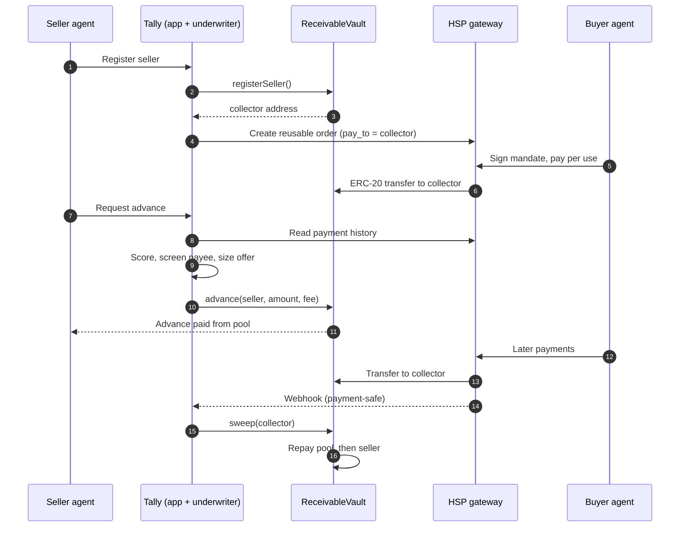
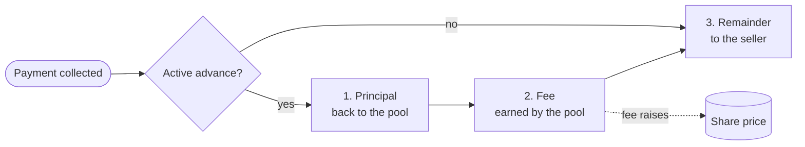
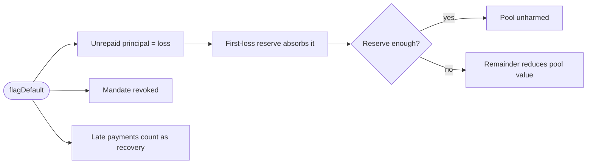
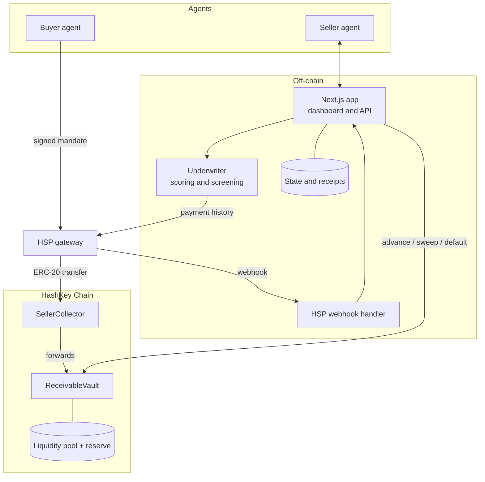

<div align="center">


# Tally

**Get paid today for what your agents will earn tomorrow.**

Receivables financing for AI agents, built on HSP reusable mandates and HashKey Chain.

[Problem](#the-problem) · [How it works](#how-it-works) · [Architecture](#architecture) · [Getting started](#getting-started) · [API](#api)

</div>

---

## The problem

Agents now sell services to other agents: research, data, code, monitoring. Each sale is small and the money arrives in drips, but the seller's costs for compute, APIs and gas are due up front.

- **Agents cannot borrow.** They have no credit score, no legal identity and no collateral.
- **Income is hard to verify.** A lender has no trusted way to confirm that an agent's income is real, recurring and routed to the borrower.
- **DeFi lending does not fit.** It demands over-collateralization, and an agent's main asset is its future income.

## The solution

Tally advances cash against income that an agent has not received yet. A seller sells on an HSP reusable mandate whose `pay_to` is a collector controlled by the Tally vault. An underwriter reads the seller's verified payment history and offers an advance. Every later payment lands in the vault and repays the pool before the seller sees a cent.

| Problem | How Tally handles it |
|---|---|
| No credit history | The underwriter scores the seller's HSP payment history: regularity, reliability and buyer concentration. |
| Unverifiable income | Payments flow through HSP, so the record is checkable. |
| Repayment risk | Income is paid into a vault-controlled collector, so the seller cannot take the advance and redirect the revenue. |
| Collateral | The mandate's future payments secure the advance. No upfront deposit. |
| Pool losses | Advances are capped, tenors are short, and a first-loss reserve absorbs defaults before liquidity providers. |
| Opaque decisions | Scoring is rule-based and every decision comes with written reasons. |

## How it works



### Repayment waterfall

Every collected payment is split in a fixed order.



### If a buyer stops paying



## Architecture



| Layer | Technology |
|---|---|
| Web app and API | Next.js (App Router), TypeScript, Tailwind |
| Contracts | Solidity, OpenZeppelin, Foundry |
| Chain access | viem |
| Payments | HSP (HashKey Merchant Platform), x402 v2 |
| Validation | zod |

## Features

- **Vault contract** with LP deposit and withdraw, share-based pool accounting, one active advance per seller, the repayment waterfall, a first-loss reserve, default handling, role separation and pause. Repayments keep flowing while new advances are paused.
- **Underwriter** with rule-based scoring, advance caps from expected income, written decline reasons, and address screening with allow and deny lists.
- **HSP client** with canonical JSON, HMAC-SHA256 request signing, ES256K merchant JWT, reusable order builder, payment queries and webhook verification.
- **Webhook handler** that is HMAC-verified and idempotent, and sweeps only on `payment-safe` or `payment-finalized`.
- **Operator dashboard** with passcode sign-in, seller registration, advance preview and take-up, pool view, audit trail, CSV export and an underwriter playground.

## Getting started

Requires Node 20+, npm, and [Foundry](https://book.getfoundry.sh/) for the contracts.

```bash
npm install
cp .env.example .env.local        # fill in the values, see Configuration
npm test                          # TypeScript tests
npm run typecheck && npm run lint

cd contracts
forge install foundry-rs/forge-std OpenZeppelin/openzeppelin-contracts --no-git
forge test
cd ..

npm run dev                       # http://localhost:3000
```

### Run it on a testnet

```bash
npx tsx --env-file=.env.local scripts/check-funds.ts    # which wallets need funds
npx tsx --env-file=.env.local scripts/testnet-setup.ts  # deploy the vault, seed the pool and reserve
npx tsx --env-file=.env.local scripts/testnet-flow.ts   # one advance and repayment on-chain
```

### Run it locally with a mocked gateway

```bash
anvil &                                   # local chain
(cd contracts && forge build)
npx tsx scripts/simulate-buyer.ts         # advance, two buyer payments, repaid
npx tsx scripts/simulate-buyer.ts --default
```

## Configuration

| Variable | Purpose |
|---|---|
| `CHAIN_RPC_URL`, `CHAIN_ID`, `CHAIN_NAME` | HashKey Chain network (testnet chain ID 133) |
| `VAULT_ADDRESS` | Deployed `ReceivableVault` |
| `UNDERWRITER_PRIVATE_KEY` | Role key that signs `registerSeller`, `advance`, `sweep` and `flagDefault` |
| `HSP_BASE_URL` | HSP QA, staging or production base URL |
| `HSP_MERCHANT_NAME` | Merchant name (`Tally`) |
| `HSP_NETWORK`, `HSP_CHAIN_ID`, `HSP_TOKEN_ADDRESS`, `HSP_COIN` | Payment method placed on each mandate |
| `HSP_APP_KEY`, `HSP_APP_SECRET` | Merchant API credentials for HMAC signing |
| `HSP_JWT_PRIVATE_KEY` | secp256k1 PEM for the ES256K merchant JWT |
| `DASHBOARD_PASSCODE` | Operator console passcode, 12+ characters |
| `API_TOKEN` | Bearer token for `/api` routes, 16+ characters |
| `DENY_LIST`, `ALLOW_LIST` | Optional address screening |
| `DATA_FILE`, `RECEIPTS_FILE` | Local state and receipt log paths |

Never commit real keys. `.env.local` is git-ignored.

## API

All routes return JSON. Token routes need `x-api-key: $API_TOKEN` or `Authorization: Bearer`.

| Route | Auth | Purpose |
|---|---|---|
| `POST /api/orders` | token | `{seller, totalUsd, expiryDays?}` registers the collector and creates a reusable HSP order |
| `POST /api/advance` | token | `{seller, requestedUsd?, dryRun?}` underwrites from HSP history and sends the advance |
| `GET /api/position?seller=` | token | Advance, amount owed and pool state |
| `POST /api/default` | token | `{seller, reason?}` writes off an active advance and revokes the mandate |
| `GET /api/receipts?seller=&format=csv` | token | Audit trail, optionally as CSV |
| `POST /api/webhook/hsp` | HMAC | HSP payment callback |

## Dashboard

| Page | Purpose |
|---|---|
| `/` | Landing page |
| `/how-it-works` | Money path and a worked example |
| `/dashboard` | Pool, sellers and recent activity |
| `/dashboard/seller` | Register a seller, preview and take an advance, mark a default |
| `/dashboard/pool` | Pool balance, LP funding and advances |
| `/dashboard/activity` | Audit trail with CSV export |
| `/dashboard/playground` | Underwriter sandbox |

## Project layout

```
contracts/          ReceivableVault, SellerCollector, tests, deploy script
src/app/            pages, server actions, API routes
src/lib/hsp/        canonical JSON, signing, ES256K JWT, orders, payments
src/lib/underwrite/ scoring, screening, rationale
src/lib/vault/      viem client for the contract
src/lib/            config, store, receipts, session, formatting
scripts/            buyer simulator, pay_to test, testnet tooling
video/              demo video build pipeline
idea.md             pitch and demo script
plan.md             build plan and status
```

## Security and limits

- Prototype. Not a live lending product; production use needs legal and compliance review.
- Credit risk is bounded by advance caps tied to payment history, short tenors, and a first-loss reserve.
- The vault is capped, pausable and non-upgradeable. It has not been audited, so use small amounts.
- Request signing follows the HSP documentation and matches independent test vectors. Acceptance by the HSP gateway is still to be confirmed against QA.

## Links

- HSP docs: https://hashkey-merchant.github.io/docs/en/
- HashKey Chain docs: https://hskchain.net/docs
- Testnet explorer: https://testnet-explorer.hskchain.net
